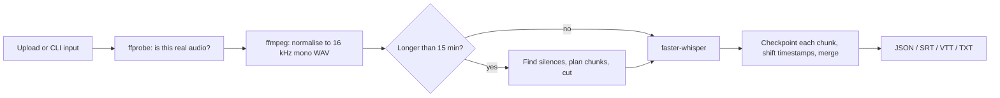

# Audio Transcription Pipeline

A small, production-minded transcription service: upload audio (or video), get back a transcript with **per-segment timestamps** as JSON, SRT, WebVTT and plain text.

- **Speech-to-text:** [faster-whisper](https://github.com/SYSTRAN/faster-whisper) (open source, runs locally on CPU, no API key)
- **Audio handling:** FFmpeg / ffprobe
- **Service:** FastAPI + a background worker with retries, checkpoints and crash recovery
- **Also usable as a script:** `python cli.py my_audio.mp3`

> The brief asks for engineering decisions, not model training. This README explains each decision and the trade-off behind it.

---

## 1. How it works



1. **Validate** with `ffprobe` (content-based, never trust the file extension).
2. **Normalise** whatever came in (MP3, M4A, FLAC, OGG, Opus, WebM, even MP4 video) into one canonical format: 16 kHz, mono, 16-bit PCM WAV. This is what Whisper models consume anyway.
3. **Chunk long audio** (above 15 minutes) at *silences* near every 10-minute mark, so words are not cut in half.
4. **Transcribe** each chunk. Language is auto-detected once on the first chunk and reused for the rest.
5. **Checkpoint** every finished chunk to disk, shift its timestamps by the chunk's start offset, and merge into one timeline.
6. **Export** to JSON (with timestamps and confidence fields), SRT, VTT and TXT.

## 2. Quick start (no Docker needed)

**Prerequisites:** Python 3.10+ and FFmpeg on your PATH.

| OS | Install FFmpeg |
|---|---|
| Windows | `winget install Gyan.FFmpeg` (then open a new terminal) |
| macOS | `brew install ffmpeg` |
| Ubuntu/Debian | `sudo apt install ffmpeg` |

```bash
# 1. create a virtual environment and install
python -m venv .venv
source .venv/bin/activate            # Windows PowerShell: .venv\Scripts\Activate.ps1
pip install -r requirements.txt

# 2. transcribe a file (first run downloads the model, ~140 MB for "base")
python cli.py path/to/audio.mp3
```

Output goes to `outputs/`: `audio.json`, `audio.srt`, `audio.vtt`, `audio.txt`, and a preview is printed:

```
Language : en (99%)
Duration : 42.3s   Segments: 9   Took: ...
  [00:00:00.000 --> 00:00:04.320] Hello and welcome ...
```

Useful options:

```bash
python cli.py talk.m4a --model small --language en --out-dir results
python cli.py talk.m4a --formats srt txt
python cli.py talk.m4a --backend mock       # fake transcript, no model download
```

### Try the long-audio path in seconds

```bash
python -m scripts.make_sample_audio --minutes 25 --out samples/long_demo.wav
python cli.py samples/long_demo.wav --backend mock -v
```

The sample is tone bursts with gaps (no speech), so the mock backend is used. It shows the file being split at silences into 3 chunks and the timestamps staying correct across chunk boundaries.

### Run as an API

```bash
uvicorn app.main:app --port 8000        # interactive docs: http://localhost:8000/docs
```

```bash
# upload -> returns 202 and a job id
curl -F "file=@audio.mp3" -F "language=en" http://localhost:8000/v1/transcriptions

# poll status and progress
curl http://localhost:8000/v1/transcriptions/<id>

# download the result
curl "http://localhost:8000/v1/transcriptions/<id>/result?format=srt"
```

Set `TRANSCRIBER_BACKEND=mock` to run the API without a model.

### Tests

```bash
pip install -r requirements-dev.txt
pytest -q
```

Tests use the mock transcriber and synthetic audio generated on the fly, so they are fast and need no model. They cover exporters, chunk planning, timestamp offsets, format handling (MP3/FLAC/OGG/M4A/Opus/MP4), checkpoint resume, retries, crash recovery and the HTTP API. Tests that need FFmpeg or FastAPI skip themselves if those are missing.

## 3. API

| Method and path | Purpose |
|---|---|
| `POST /v1/transcriptions` | Multipart upload (`file`, optional `language`). Returns **202** with a job id and a `Location` header. |
| `GET /v1/transcriptions/{id}` | Status (`queued`, `processing`, `completed`, `failed`), progress 0-1, attempts, error, links. |
| `GET /v1/transcriptions/{id}/result?format=json\|srt\|vtt\|txt` | The transcript. **409** with `Retry-After` while unfinished, **422** if the job failed. |
| `GET /health` | Liveness and active engine. |

Other status codes: 400 empty file, 413 over the size limit, 415 unsupported type, 404 unknown job.

JSON result shape:

```json
{
  "language": "en",
  "duration_sec": 42.3,
  "model": "faster-whisper:base",
  "text": "Hello and welcome ...",
  "segments": [
    {"id": 0, "start": 0.0, "end": 4.32, "text": "Hello and welcome ...", "avg_logprob": -0.21, "no_speech_prob": 0.01}
  ]
}
```

## 4. Design decisions and trade-offs

**Async job API instead of a blocking request.** Transcription takes seconds to minutes. Holding an HTTP request open invites proxy timeouts and wastes connections. The API returns 202 immediately; clients poll (a webhook is the natural next step).

**faster-whisper on CPU with `int8`.** It reuses OpenAI's Whisper weights on the CTranslate2 runtime: noticeably faster and lighter than the reference implementation, with a small accuracy cost on CPU. `base` is the default for a laptop demo; set `WHISPER_MODEL=small` (or larger) when accuracy matters more than speed.

**Normalise first, with FFmpeg.** One decode path for every input format gives predictable behaviour, a single place to validate, and makes chunking trivial because every chunk is the same simple WAV.

**Silence-aware chunking, not fixed slices.** A hard cut every 10 minutes can slice a word. We look for the silence closest to each ideal cut point (+/- 60 s) and cut in its middle; with no silence nearby we fall back to the exact mark. Cutting without overlap means no duplicate text to de-duplicate later.

**Checkpoint per chunk.** A crash on chunk 9 of 12 should not cost 9 chunks of CPU time. The chunk plan and every chunk result are written atomically (temp file + rename). A retry reuses them.

**Retry only what can succeed.** Errors carry a `retryable` flag. A corrupt file fails immediately (retrying wastes CPU); a decode timeout or model-load hiccup is retried with exponential back-off (2 s, 4 s, ...), up to 3 attempts. A job that keeps crashing the process is eventually abandoned instead of looping forever.

**SQLite for job state, a thread pool for execution.** No Redis or Celery needed to run the demo, but the shape matches production: state in a database, workers pulling job ids, unfinished jobs re-queued on start-up. `WORKERS=1` is the default because one CPU-bound model instance already uses the cores.

**VAD filter on, `condition_on_previous_text` off.** Voice-activity detection skips silence and music (less hallucinated text). Turning off previous-text conditioning avoids the repetition loops Whisper can fall into on long audio, at a small cost in cross-sentence consistency.

**Storage behind one small class.** Paths live in `app/storage.py` only. Uploads are saved as `original.<ext>`; the user's filename is stored as metadata and never used as a path (no path traversal).

**Mock backend as a first-class option.** The transcriber is a tiny interface (`transcribe(wav, language)`). A mock implementation makes tests fast and lets reviewers run everything without downloading a model.

## 5. Configuration (environment variables)

| Variable | Default | Meaning |
|---|---|---|
| `TRANSCRIBER_BACKEND` | `faster-whisper` | `faster-whisper` or `mock` |
| `WHISPER_MODEL` | `base` | `tiny`, `base`, `small`, `medium`, `large-v3` |
| `WHISPER_DEVICE` / `WHISPER_COMPUTE_TYPE` | `cpu` / `int8` | Use `cuda` / `float16` on a GPU |
| `DATA_DIR` | `data` | Where jobs, uploads and results are stored |
| `MAX_UPLOAD_MB` | `500` | Upload size limit |
| `CHUNK_THRESHOLD_SEC` / `CHUNK_TARGET_SEC` | `900` / `600` | When to chunk, and the target chunk length |
| `WORKERS` | `1` | Concurrent transcription jobs |
| `MAX_ATTEMPTS` / `RETRY_BASE_DELAY_SEC` | `3` / `2` | Retry policy |
| `KEEP_WORK_FILES` | `0` | Keep intermediate files for debugging |

## 6. From this demo to production

The code is deliberately small. This is how it would grow for a real client workload:

| Concern | This repo | Production |
|---|---|---|
| Concurrency | Thread pool in the API process | API only enqueues; separate worker fleet scaled on queue depth (SQS or Celery/Redis), GPU workers for heavy load |
| Uploads | Streamed through the API | Pre-signed URL straight to object storage; enforce size limit at the proxy |
| Storage | Local disk | Audio and transcripts in S3/GCS/Azure Blob with lifecycle rules; metadata in PostgreSQL |
| Retries | In-process timer | Queue visibility timeout + dead-letter queue + alarm |
| Idempotency | None | `Idempotency-Key` header or content hash to avoid double-processing |
| Auth and tenancy | None | API keys or OAuth, per-tenant quotas and storage prefixes |
| Notification | Polling | Webhooks on completion/failure |
| Observability | Logs | Structured logs, metrics (queue depth, real-time factor, failure rate), traces |
| Quality | None measured | Word-error-rate on a labelled set of representative audio before choosing a model size |

## 7. Known limitations

- **No speaker diarisation** and no word-level timestamps (segment-level only, as requested).
- **Accuracy depends on the model size and audio quality.** `base` is fast but not the most accurate; noisy audio and heavy accents benefit from `small` or larger. Accuracy was not benchmarked here.
- **Upload size limit is checked as the upload is saved.** The web framework still receives the body first, so a real deployment must also limit request size at the reverse proxy or use direct-to-storage uploads.
- **In-process queue.** Jobs survive restarts (they are re-queued), but there is no horizontal scaling until the queue moves out of process.
- **Silence-based chunking assumes there are pauses.** Continuous speech or music falls back to fixed cut points, which may split a word at the boundary.
- **Local disk, no auth, no retention policy.** Fine for a demo; see section 6.

## 8. Project layout

```
app/
  main.py          FastAPI routes
  jobs.py          SQLite job store, worker, retries, recovery
  pipeline.py      validate -> normalise -> chunk -> transcribe -> merge (with checkpoints)
  audio.py         ffprobe/ffmpeg helpers, silence detection, chunk planning
  transcriber.py   faster-whisper engine + mock engine
  exporters.py     JSON / SRT / VTT / TXT
  storage.py       on-disk layout (single place that knows paths)
  config.py        settings from environment variables
  models.py, errors.py
cli.py             command-line entry point
scripts/make_sample_audio.py   synthetic audio for plumbing tests
tests/             unit, pipeline, job-runner and API tests
Dockerfile         optional container image
```
